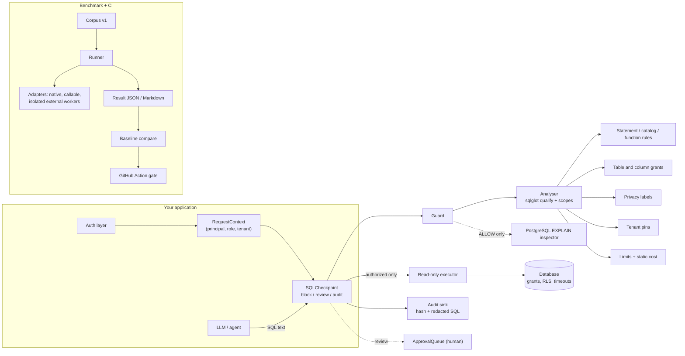

# SQLGuard Ninja

**Security testing, policy enforcement, agent integration, privacy analysis and CI
benchmarking for LLM-generated SQL.**

[](https://github.com/Pratik653/SQLGuard_Ninjapy/actions/workflows/ci.yml)


When an LLM writes SQL, the system prompt is not a security boundary. SQLGuard Ninja sits
between the model and the database. It checks every statement against a declared policy for
the *authenticated* caller: which tables and columns a role may use, which data classes may
appear only in aggregates or only after human approval, and which tenant the caller belongs
to. It records an audit trail and gives the agent an explanation it can act on.

It ships with a labelled benchmark corpus (530 cases, 1,002 dialect evaluations) and a
regression gate for CI. The same benchmark harness can evaluate other open-source guards
side by side.

> **One layer, not the only one.** Static SQL inspection cannot guarantee database security.
> Use a read-only least-privilege role, row-level security and statement timeouts as well.
> See the [threat model](docs/security/THREAT_MODEL.md).

## What it does

| Workstream | What you get | Status |
|---|---|---|
| **Policy engine** | Read-only enforcement, table/column grants, tenant isolation, function and catalog rules, structural limits. Built on [sqlglot](https://github.com/tobymao/sqlglot). Fails closed when analysis is incomplete. | PostgreSQL + SQLite tested |
| **Privacy pack** | Explicit classification labels, `deny` / `aggregate_only` / `review` per role, JSON-path labels, small-cohort review, minimisation hints and alternatives | implemented |
| **Agent integrations** | `SQLCheckpoint` with block / review / audit modes, hash-bound single-use approvals, retry lock-out, redacted audit events. LangChain tool, LangGraph nodes, FastAPI router | implemented |
| **Benchmark engine** | Versioned corpus, metrics (recall, precision, FPR, FNR, exact match, per category/dialect, latency percentiles), adapters for native, callable and isolated external validators, JSON and Markdown reports | implemented |
| **Query cost** | Explainable static score; optional PostgreSQL `EXPLAIN (FORMAT JSON)` inspection, gated and read-only | implemented |
| **CI** | Composite GitHub Action and CLI gate: security, usability, label-change and error regressions against an approved baseline | implemented |

Not yet included: governed writes (all writes are denied in v0.1); benchmark cases for
restricted functions and system catalogs (the rules exist, but the corpus does not cover
them); dialects beyond PostgreSQL and SQLite (they parse, but are untested). Full list:
[KNOWN_LIMITATIONS.md](KNOWN_LIMITATIONS.md).

## Architecture



Design decisions and their trade-offs are recorded in
[ARCHITECTURE_DECISIONS.md](docs/architecture/ARCHITECTURE_DECISIONS.md).

## Five-minute quick start

Not published on PyPI yet. Install from source:

```bash
git clone https://github.com/Pratik653/SQLGuard_Ninjapy.git
cd SQLGuard_Ninjapy
python -m pip install -e ".[all]"
```

Validate a query:

```bash
sqlninja validate --policy benchmarks/policies/retail_saas.yaml --role support_analyst --tenant 1 \
  --sql "SELECT o.id FROM orders o WHERE o.tenant_id = 1 OR 1 = 1"
```

```
DENY:
  [deny] tenant.missing_predicate: Every read of table 'orders' must filter on the caller's tenant. Suggestion: Add `o.tenant_id = :tenant_id` to the WHERE clause of the scope that reads this table.
```

Exit codes: 0 allow, 1 deny, 3 review, 2 usage error.

Run the demos (deterministic; no API key needed):

```bash
python examples/sdk/quickstart.py
python examples/sqlite/text_to_sql_demo.py
python examples/langgraph/sql_agent_demo.py
```

Start your own project:

```bash
sqlninja init my-project && cd my-project
sqlninja benchmark run --config sqlninja.yaml
```

## Python SDK

```python
from sqlguard_ninja import Guard, Policy

guard = Guard(Policy.from_file("benchmarks/policies/retail_saas.yaml"))
result = guard.validate(
    "SELECT department, AVG(salary) FROM employees GROUP BY department",
    role="hr_analyst",
    dialect="postgres",
)
result.allowed      # True
result.findings     # () - structured Finding objects with rule_id, action, message, remediation

guard.validate("SELECT full_name, salary FROM employees", role="hr_analyst").explain()
# DENY:
#   [deny] privacy.aggregate_only: The column 'employees.salary' may only be used inside
#   statistical aggregates (COUNT, SUM, AVG, ...), not as individual values. ...
```

## LangGraph

```python
from sqlguard_ninja.integrations import RequestContext, SQLCheckpoint
from sqlguard_ninja.integrations.langgraph import (
    CONTEXT_KEY, make_execute_node, make_guard_node, route_after_guard)

checkpoint = SQLCheckpoint(guard, mode="block", max_denied_attempts=3)
graph.add_node("guard", make_guard_node(checkpoint))
graph.add_node("execute", make_execute_node(checkpoint, executor))   # re-validates
graph.add_conditional_edges("guard", route_after_guard(3),
                            {"execute": "execute", "revise": "generate", "end": END})

ctx = RequestContext(principal=user.id, role=user.role, tenant_id=user.tenant_id)
app.invoke(state, config={"configurable": {CONTEXT_KEY: ctx}})       # nodes cannot alter config
```

More in [AGENT_INTEGRATION.md](docs/guides/AGENT_INTEGRATION.md): the LangChain tool (its
schema accepts only `query`), the FastAPI router, review-mode approvals and audit sinks.

## Benchmark

```bash
sqlninja benchmark run --dataset benchmarks/datasets/v1 --adapter native
python scripts/setup_external_adapters.py          # isolated venvs for other tools
sqlninja benchmark run --dataset benchmarks/datasets/v1 --adapter external:sql-guardrail
sqlninja benchmark compare --baseline benchmarks/baselines/native.json --candidate results/latest.json
```

Results for corpus v1.0.0 (Windows 11, Python 3.11, 1,002 evaluations). Details and raw files:
[RESULTS_v1.md](docs/benchmarks/RESULTS_v1.md).

| Validator | Recall | Precision | FPR | Recall / FPR within declared capability | p95 ms |
|---|---:|---:|---:|---:|---:|
| SQLGuard Ninja 0.1.0 | 100.0% | 100.0% | 0.0% | 100.0% / 0.0% | 2.21 |
| sql-guardrail 0.5.2 | 98.6% | 86.6% | 21.2% | 98.3% / 19.3% | 1.80 |
| agent-sql-guard 0.2.0 | 67.9% | 86.6% | 14.5% | 89.5% / 17.2% | 1.27 |
| krish2105/sqlguard 0.1.0 | 65.8% | 91.4% | 8.6% | 83.5% / 5.2% | 1.24 |

**Read the native row with care.** The corpus and the engine were developed together, and
every disagreement was triaged by fixing the engine or correcting a label (both are logged).
100% shows consistency with the documented semantics, not independent detection quality. The
other tools have smaller policy models (no roles, labels, aggregate-only access or review), so
the "within capability" column is the fairer comparison. Methodology and threats to validity:
[BENCHMARK_METHODOLOGY.md](docs/guides/BENCHMARK_METHODOLOGY.md).

## How it relates to existing tools

SQLGuard Ninja uses **sqlglot** for parsing, dialects and scope analysis, and does not
re-implement them. [sql-guardrail](https://github.com/nickusevich/sql-guardrail) is a
thorough read-only validator with a tautology catch-all, which this project does not
duplicate. [agent-sql-guard](https://github.com/sakura-sky/sql-guard) has a careful
schema-less PII denylist. What SQLGuard Ninja adds: role- and label-based policies, the agent
checkpoint contract, a shared benchmark with isolated adapters, planner inspection, and the
CI gate. Full comparison: [COMPETITIVE_ANALYSIS.md](docs/research/COMPETITIVE_ANALYSIS.md).

## Documentation

* [Policy reference](docs/guides/POLICY_REFERENCE.md)
* [Agent integration](docs/guides/AGENT_INTEGRATION.md)
* [Query cost](docs/guides/QUERY_COST.md)
* [CI integration](docs/guides/CI_INTEGRATION.md)
* [Benchmark methodology](docs/guides/BENCHMARK_METHODOLOGY.md)
* [Threat model](docs/security/THREAT_MODEL.md)
* [Architecture decisions](docs/architecture/ARCHITECTURE_DECISIONS.md)
* [Known limitations](KNOWN_LIMITATIONS.md) · [Roadmap](ROADMAP.md) · [Changelog](CHANGELOG.md)

## Supported versions

* Python 3.11, 3.12, 3.13 (CI matrix on Linux and Windows).
* SQL dialects: **PostgreSQL** (tested against PostgreSQL 16) and **SQLite**. Other sqlglot
  dialects parse but are experimental and untested.

## Development

```bash
python -m pip install -e ".[dev]"
ruff check src tests scripts examples && ruff format --check src tests scripts examples
mypy
pytest                          # PostgreSQL tests run if SQLNINJA_PG_DSN is set or pgserver is installed
python scripts/generate_corpus.py --check
```

See [CONTRIBUTING.md](CONTRIBUTING.md). Report vulnerabilities privately per
[SECURITY.md](SECURITY.md).

## Licence

Apache-2.0. No third-party code is vendored; dependencies and their licences are listed in
[THIRD_PARTY_NOTICES.md](THIRD_PARTY_NOTICES.md). All benchmark data is synthetic.
